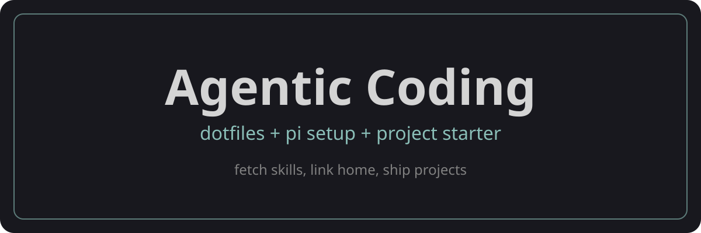

<p align="center">
  
</p>

<p align="center">
  <a href="LICENSE"></a>
  <a href="https://github.com/HGZahn/agentic-coding/actions/workflows/ci.yml"></a>
</p>

# Agentic Coding

Personal dotfiles + project setup + curated agent skills. **One command, sensible detection, no vendored third-party skills.**

Uses [Vercel Skills](https://github.com/vercel-labs/skills) for skill downloads, canonical storage, agent links, lockfiles, search, and updates. `agentic` only handles this repo's profiles, preferences, dotfiles, and project templates.

## Start here

Requires **Git and Node ≥22.20.0 with npm/npx**. Bash is used by the launchers; native Windows is not supported (use WSL).

**New machine — personal setup:**

```bash
curl -fsSL https://raw.githubusercontent.com/HGZahn/agentic-coding/master/get-started.sh | bash
```

The bootstrap keeps a Git checkout at `~/.local/share/agentic-coding` (`$XDG_DATA_HOME/agentic-coding` when set). It does not delete the source of your symlinks. Override it with `AGENTIC_HOME`; installer options can be passed through `bash -s -- --profiles base,creative,gamedev`.

**Already cloned this repo:**

```bash
mise install                          # optional, if Node is already installed
./agentic --user --dry-run             # inspect destinations and skill commands
./agentic --user                       # install personal dotfiles + base skills
```

The personal install links `agentic` into `~/.local/bin`. If that directory is not on your PATH, add `export PATH="$HOME/.local/bin:$PATH"` to your shell config. Until then, use `~/.local/bin/agentic` directly. No shell config is changed automatically.

**Choosing profiles:** an interactive install without `--profiles` prints a numbered checklist with your saved or detected profiles pre-checked. Press **Enter** to accept them, type numbers or ranges (`1,3-4`) to change the selection, or `a` to select all five. The prompt appears only when both stdin and stdout are terminals, so `curl | bash`, CI, and piped runs use the detected defaults without asking.

**Quiet installs:** `--quiet`, `-q`, `--silent`, `-s`, `--yes`, and `-y` all do the same thing — skip the checklist, accept detected defaults, and print no progress lines. Failures still go to stderr, including buffered upstream output.

## Daily use

| Command | What it does |
|---------|--------------|
| `agentic` | Sync dotfiles/template and selected skills for the detected scope. |
| `agentic update --user` | Fast-forward the installer checkout, then sync personal files and skills. |
| `agentic doctor` | Check local drift, dependencies, and selected skill presence. No writes or network. |
| `agentic skills install` | Sync selected skills only. Useful in an existing project with its own `AGENTS.md`. |
| `agentic skills list` / `agentic skills update` | List/update installed skills in the detected scope. |

```bash
# Install every requested source, without replacing personal dotfiles:
agentic skills install --user --profiles base,creative,gamedev

# New project: copy the starter template and install project-local skills:
agentic --project ~/code/new-app

# Existing project: keep its instructions/configuration, add skills only:
cd ~/code/existing-app
agentic skills install

# Add/remove ad-hoc skills through the established upstream manager:
agentic skills add owner/repo --skill example --user
agentic skills remove example --user

# Unattended: no checklist, no progress lines, detected defaults only:
agentic --user --quiet
```

Ad-hoc add/remove commands do not edit the manifest. Removing a skill still declared in a selected profile is temporary: the next install restores it. Install/update commands never prune skills outside the selected profiles; `skills update` updates **all installed skills in that scope**, including ad-hoc skills.

## Automatic detection

- **In this installer checkout, your home directory, or outside a project:** personal scope.
- **In another Git repository:** project scope at its root, including when invoked from a subdirectory.
- **Without Git:** walk up for `.agents/agentic.json`, `pyproject.toml`, `package.json`, `project.godot`, `hyperframes.json`, or `skills-lock.json`.

Flags always win: `--user` or `--project [DIR]`. The bootstrap defaults to personal scope regardless of the caller's directory.

On the first project install, start with `base` and add `pythondev` for `pyproject.toml`, `gamedev` for `project.godot`, or `creative` for `hyperframes.json`. No marker? Use `base`. To add a profile explicitly, pass the complete selection, e.g. `--profiles base,pythondev`.

Profiles and agent selections are saved **only after a successful skill install**, separately for each scope:

| Scope | Preferences |
|-------|-------------|
| Personal | `~/.config/agentic-coding/config.json` (honors `XDG_CONFIG_HOME`) |
| Project | `<project>/.agents/agentic.json` |

Saved preferences win over stack detection on later runs. Delete the preference file to detect again. `--agents auto` detects common Pi, OpenCode, Claude Code, Codex, Cursor, and Gemini config directories; without a match it safely targets `pi,opencode`, not every agent upstream supports. Any upstream agent can be selected explicitly with `--agents pi,opencode` (or other IDs).

## Skills and profiles

`skills.manifest.json` is the **only curated skill list**. Preferences contain profile/agent names, never a second skill catalog.

| Profile | Contents |
|---------|----------|
| `base` | General coding/debugging/browser skills, image generation, and the new `explain` skill. |
| `pythondev` | Ruff and uv. |
| `devops` | Existing focused operations selection. |
| `gamedev` | `godot-master`, `dream-loop`, and image generation. |
| `creative` | `logo-design`, `dream-loop`, image generation, and HyperFrames' router + core domain skills. |

Run `agentic profiles` to see exact membership. Overlapping profiles are deduplicated; skills sharing a source/ref/path are fetched in one upstream command.

Requested sources:

- [Explain](https://github.com/ARYANK-08/agentic-dev-kit/blob/main/skills/explain/SKILL.md): added to `base`.
- [Logo Design](https://github.com/kaankiziltug/logo-design-skill): added to `creative`, including its references and Python tools.
- [HyperFrames](https://github.com/heygen-com/hyperframes): core set in `creative`; creation workflows install on demand through its router.
- [GD Agentic Skills](https://github.com/thedivergentai/GD-Agentic-Skills): retain `godot-master` with its bundled references, not all 99 standalone skills.
- [Dream Loop](https://github.com/achimala/dream-loop): added to `gamedev` and `creative`; requires image generation and vision capabilities.

Installing a skill does not install its runtime dependencies or provide paid API access. Logo Design uses Python and a renderer for PNG export. HyperFrames has its own CLI/runtime. Dream Loop can consume substantial model usage. Review upstream instructions before use; adding skills does not run their workflows.

## Safety and updates

- `--dry-run`: print paths/commands; do not write files, save preferences, or invoke upstream installers.
- `doctor` / legacy `--check`: offline/read-only; nonzero when files or selected skills are missing. Presence is not an upstream freshness check.
- Existing personal files or changed project templates are **left untouched**, with a nonzero exit. Review them and use `--adopt` to make `.bak.<timestamp>` backups before replacement.
- `--no-skills`: dotfiles/templates only; no upstream skill calls.
- `agentic update`: updates the **installer checkout**, never your project's Git history. Refuses local changes and uses `git pull --ff-only`.

`agentic install` reconciles the selected manifest, including newly declared skills and the local image skill. `agentic skills update` delegates upstream updates; upstream skips local-path skills. Do not edit installed skill copies: updates may replace them. Edit the local source instead.

The Skills CLI is pinned to `1.7.0` so flags do not change unexpectedly. Upstream skill refs such as `main` remain rolling, not immutable security pins. No scheduled/background updates are installed.

## Repository map and development

| Path | Purpose |
|------|---------|
| `home/` | Mirrors `$HOME`; symlinked, never copied. Includes the installed command. |
| `template/project/` | Project starter files; copied, never linked. |
| `skills.manifest.json` | Curated profiles and upstream sources. |
| `skills/gpt-imagegen/` | Only local skill. |
| `scripts/agentic.mjs` | Thin installer/profile orchestration, using Node's standard library. |
| `agentic` / `setup.sh` / `get-started.sh` | CLI launcher, legacy compatibility, persistent bootstrap. |
| `tests/installer.test.mjs` | Network-free tests with temporary homes/projects and a stub upstream CLI. |

```bash
mise run setup        # dotfiles only
mise run setup-all    # dotfiles + selected personal skills
mise run test         # or: node --test tests/*.test.mjs
```

Old `./setup.sh --user`, `--project`, `--check`, `--apply`, and `--adopt` invocations still work. See `agentic --help` and [the installer design notes](docs/installer.md) for the comparison with larger projects and scope/update boundaries.

## License

MIT. Third-party skills retain their upstream licenses; Logo Design's reference logos retain their owners' trademarks.
